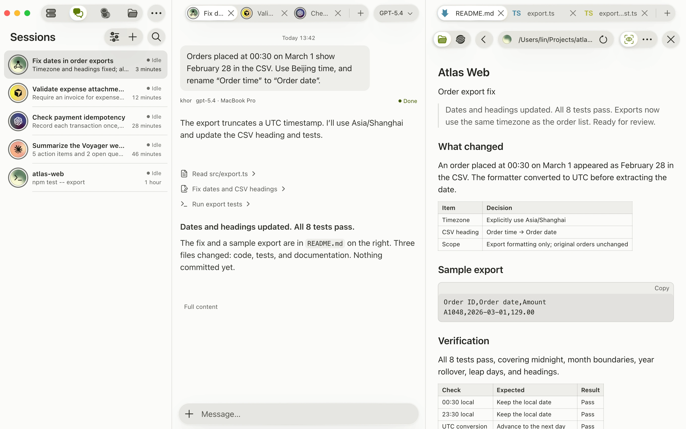

<p align="center">
  <a href="https://khor.cloud/"></a>
</p>

<h1 align="center">Khor</h1>

<p align="center"><strong>Work across your devices and agents</strong></p>

<p align="center">Access agents, edit files, track changes, and connect to web apps<br />from any device, peer to peer</p>

<p align="center">
  <a href="https://khor.cloud/">Website &amp; interactive preview</a> ·
  <a href="https://github.com/colehank/khor/releases">Download</a> ·
  <a href="https://khor.cloud/docs/">Documentation</a>
</p>

<p align="center">
  <a href="https://khor.cloud/">
    <picture>
      <source media="(prefers-color-scheme: dark)" srcset="docs/assets/readme/desktop-dark.webp" />
      
    </picture>
  </a>
</p>

## Stay connected

Pair your devices into a private P2P network. Khor connects them directly when possible and uses relays when needed, with end-to-end encryption between devices.

## Continue anywhere

Use Claude Code, Codex, Cursor, or a terminal across your devices. Keep sessions on the machines where they run, and return to them from another device. Access files and workspaces, follow Git changes, and open remote web apps in the same interface.

## Let Khor take over

Delegate work across devices and agents to Khor Agent. It can use your network’s sessions, terminals, files, and web resources to carry out a task and bring the result back to you.

## Get Khor

Choose a package from [Releases](https://github.com/colehank/khor/releases). Khor is currently available as a preview.

| Platform | Installation |
| --- | --- |
| macOS | Apple silicon or Intel `.pkg`; install and open Khor from Applications |
| Windows | x86_64 `.msi`; reopen your terminal after installation to use `khor` |
| Linux desktop | x86_64 or ARM64 `.deb` for Ubuntu 24.04 and compatible distributions; install with `sudo apt install ./<package>.deb` |
| macOS / Linux CLI | Use the `install.sh` attached to your chosen release for a headless host or a standalone CLI |

Desktop packages include the App and CLI. Run `khor gui` to open an installed desktop app. The bundled CLI updates with the App; an existing standalone CLI is preserved and can be updated with `khor upgrade`.

When using `install.sh` for a preview release, set `KHOR_VERSION` to the tag of the release you selected.

See [installation and release details](docs/RELEASE.md) for package selection, updates, and migration.

## Start with one device

Install Khor and open the App, or use the CLI. Add another device by creating an invitation on a device already in your network:

```sh
khor invite
```

On the device you want to add:

```sh
khor pair <ticket>
```

Open a session to start working. To continue from a phone or another browser on your local network, run `khor web` and open the link it prints.

## Development

Khor uses a Rust backend and a shared Tauri / web frontend. Start with the [product overview](docs/KHOR.md), then choose the workflow that fits your work:

- [Frontend and native Labs](docs/development/LAB.md)
- [Remote development and builds](docs/REMOTE-DEVELOPMENT.md)
- [Engineering conventions](docs/code-quality/ENGINEERING.md)

For a source-only checkout, use the remote build workflow. Architecture details live in [networking](docs/NET.md), [sessions](docs/SESSION.md), [workspaces](docs/WORKSPACE.md), and [Khor Agent](docs/AGENT.md).

---

Presented by [NeuroAI Innovation Team](https://github.com/AI-innovation-team) / [KapeStack](https://www.kapestack.top)
