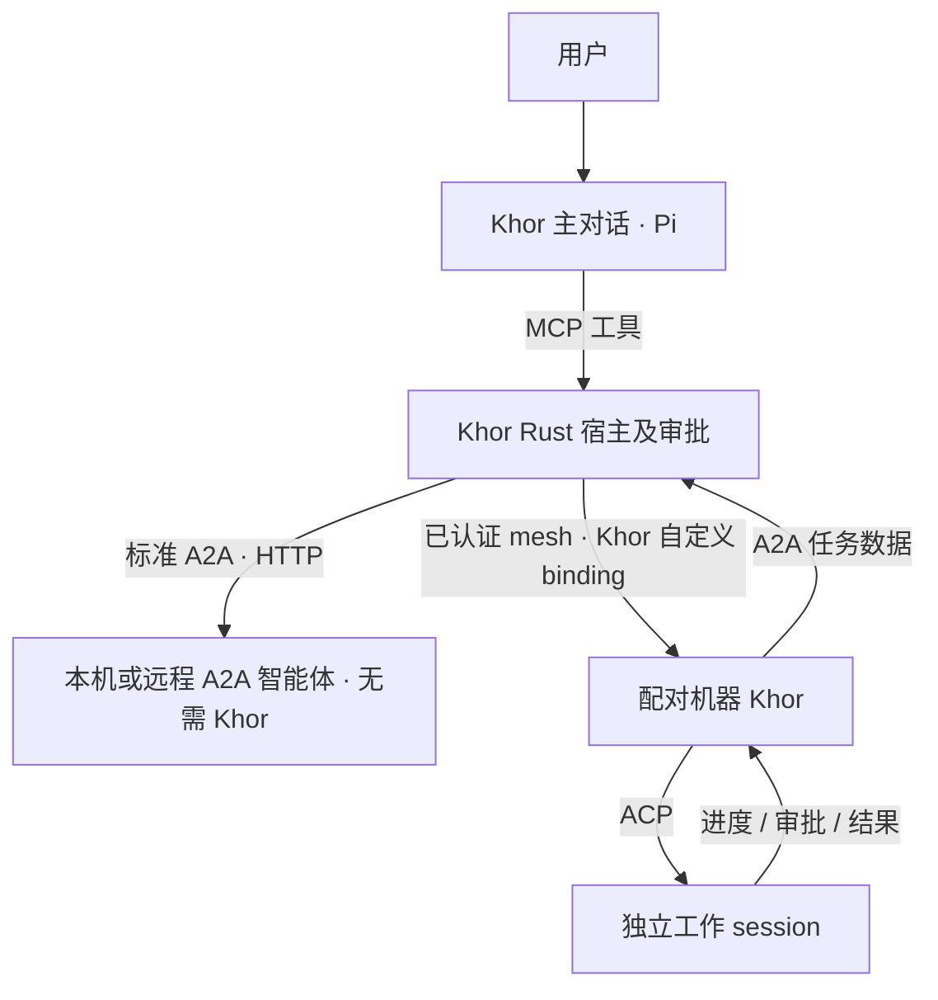

# 智能体协作：本机与远程智能体

2026-10-23。Khor 主对话负责理解目的、选择执行者、跟踪任务和带回结果；本机或其他机器上的智能体承接具体工作。协作协议采用 **A2A 1.0**。Khor 可以直接连接本机或远程的原生 A2A HTTP 智能体，对方机器无需安装 Khor；也可以通过配对的 Khor 机器驱动其 ACP 智能体。

## 当前交付

| 层 | 已实现 | 后续 |
| --- | --- | --- |
| 协议数据 | 官方 Rust SDK 的 v1 Task、Message、Artifact；Agent Card 发现；JSON-RPC / HTTP+JSON 客户端 | 入站 HTTP 服务、流式订阅 |
| 任务记录 | 执行机器私有存储、消息去重、上下文/session 绑定、分页读取 | 保留期与归档 |
| 执行控制 | 原生 A2A 任务、产物、补充输入、查询和取消；独立 ACP 宿主及审批 | 文件下载与产物展示 |
| 跨设备 | 直连 A2A HTTP 服务；配对身份认证、IPC/mesh 路由 | OAuth 流程及其他 HTTP 认证方式 |
| 产品入口 | Pi 的九个协作 MCP 工具、CLI 连接登记、现有 ACP 会话和审批界面 | 专用任务面板、@ 引用 |

代码在 `crates/a2a`、`crates/node/src/a2a_http.rs`、`delegation.rs` 和 `gui_host.rs`。ACP 路径的执行机器需注册 agent、安装程序并完成其自身登录；原生 A2A 路径只需已有 HTTP 服务的地址和必要认证。Khor 不负责远程安装智能体。



MCP 向 Pi 提供协作工具；A2A 管理智能体间的消息和任务；ACP 驱动本地进程。Khor 当前作为 A2A HTTP 客户端，不开放入站 HTTP 服务。

## 直接连接 A2A 智能体

本机示例：

```sh
khor agents connect researcher http://127.0.0.1:9000
```

远程示例：

```sh
khor agents connect researcher https://agent.example.com
```

地址也可直接填写 Agent Card 的 `.json` URL；服务根地址会追加 `/.well-known/agent-card.json`。连接时读取 Card，按官方 SDK 协商 A2A v1 的 JSON-RPC 或 HTTP+JSON 接口，并保留接口 tenant。名字使用 1–64 个英文字母、数字、连字符或下划线。登记名返回 `a2a:researcher`，与 ACP 程序名分开。之后在主对话中说“让 researcher 调研这个问题”即可。

需要 Bearer 认证时使用 `khor agents connect researcher <地址> --token-stdin`，从标准输入交付 token；凭据不放命令参数、MCP 调用或提示词里。HTTP 认证只允许 HTTPS 或回环 HTTP。当前支持匿名和 Bearer，尚未实现 OAuth 登录及其他认证类型。已有任务会采用同一服务更新后的凭据。

登记和凭据留在连接发起机器，不加入网络同步。MCP 的 `machine` 可以省略，表示 Khor 主对话的执行机器；填写已配对机器则由它连接服务，用于服务只在那台机器的回环或内网可达的情况。这里的 machine 是连接发起端，A2A 服务本身无需 Khor 或设备配对。

Card 和所选接口必须同源；不跟随重定向，也不接受 URL 内嵌凭据、查询串或 fragment。同一名字不能改绑另一个 Card 地址，改服务应新建名字。`khor agents disconnect a2a:researcher` 断开登记，已有任务仍按原接口查询、继续和取消。

原生 A2A 直接保留服务返回的 taskId、contextId、history 和 Artifact，不伪造 ACP session。返回独立 Message 时直接交付结果。InputRequired 通过 `delegate` 携带原 task、context、用户答复和新的 request 继续同一任务；普通后续工作只携带 context，创建新任务。AuthRequired 需要按服务要求配置认证，不能当成工具审批。

查询和取消只允许调用设备已登记回执的任务；不会把服务其他用户的任务列给模型。`task_list` 返回本地回执（`cached=true`），使用 `next` 分页；`task_status` / `task_wait` 从服务刷新，当前采用轮询。错误保留标准 A2A 错误类型和编号，不将可能回显凭据的服务错误正文交给模型。

HTTP 线上的 messageId 由连接端、调用设备、agent 名和 request 确定，避免不同设备的同名 request 冲突；重试保持不变。发送前先写持久意图。相同 request 的相同消息只返回原回执；改参数则拒绝。若发送响应丢失或进程中断，再次调用会用标准 ListTasks 和消息 ID 查回原任务，不自动重发。查找最多四页、每页五十个任务、历史一百条；无法查回时明确报告结果不确定，需检查服务。Task 列表也会尝试整理少量未确认发送，便于父任务 Stop 查回并取消；服务不可达时不保证送达。

本地 HTTP 回执在 `.khor/a2a/http/`，凭据文件仅当前用户可读。输入上限 128 KiB，Card 上限 256 KiB，保存的单任务或直接 Message 上限 1 MiB，账本上限 32 MiB；超限拒绝保存，不自动截断任务。HTTP 响应解析由官方 SDK 完成。运行任务、取消效果与持久化由对方服务负责，连接端重启不会重放工作，也不会凭本地状态宣称远端失败。

## ACP 的 Khor 自定义 binding

`Node::delegation_on(machine, Action)` 是 Pi 和本机调用方共享的业务入口。已有 resident 存在时先经有 cookie 的 IPC 转发，再由其复用 mesh；否则建立临时 endpoint。本机仍走同一任务实现。卫星 SSH 机器不充当委派执行端。

| 操作 | 语义 |
| --- | --- |
| Agents | 读取目标机器注册表，并检查程序路径；不声称登录已经可用 |
| Send | 持久接受官方 Message，显式新建/复用 ACP session 并提交 prompt |
| Get / List | 只读任务回执；List 每页五十条，以 taskId 为游标 |
| Wait | 最多八秒等待 revision 变化、任务终态或待批；不重新派发 |
| Answer | 校验当前审批编号与所列选项，再回答原 ACP permission |
| Cancel | 持久写入指定 task 的取消意图，由持有该 task 的 ACP 宿主轮询并停止 |

网络帧使用新增 `Request::Delegation` / `Response::Delegation`；IPC 使用对应新 variant。外层采用仓库现有长度受限的 MessagePack；Delegation 的操作和回答以官方 SDK 的 canonical JSON 字符串承载，避免可选字段省略造成位置错位。MCP 输出为普通 JSON 对象。调用方不是载荷中的自由字段：远端从已认证 iroh 公钥导出，本机从节点身份导出。父任务的 home 必须等于调用方。所有操作经过既有配对准入门，发送、回答和取消不走 0-RTT。旧节点拒绝未知 variant，错误返回工具调用方，不自动换机执行。

这是 Khor 自定义 binding，不宣称实现标准 JSON-RPC/REST 的全部请求、错误码、订阅、Agent Card 或推送通知。当前错误通过既有 Refused/工具 isError 返回；原生 HTTP 路径使用官方客户端的标准错误与线格式。

## 使用方式

在 Khor 主对话里直接说“让某台机器上的某智能体处理这个任务”。模型先用 `agents` 确认名称，再调用 `delegate`。发起委派和回答子智能体的权限请求分别经过 Khor 写操作审批；用户也可打开返回的 ACP 工作 session，直接回答其原有审批。

| MCP 工具 | 参数 |
| --- | --- |
| agents | 可选 machine |
| agent_connect | agent、url；可选 machine |
| agent_disconnect | agent（a2a:名字）；可选 machine |
| delegate | agent、prompt、稳定唯一 request；可选 machine、context、task；cwd 仅限新 ACP 上下文 |
| task_status | agent、task；可选 machine |
| task_wait | agent、task、最新 revision 的十进制字符串；可选 machine |
| task_answer | agent、task、ask 字符串；可选 machine；option 为原 ACP 选项 ID，省略表示拒绝 |
| task_cancel | agent、task；可选 machine |
| task_list | agent；可选 machine、context、after |

外部 CLI 客户端通过 `khor mcp` 使用相同目录，例如逐行发送：

```json
{"jsonrpc":"2.0","id":1,"method":"tools/call","params":{"name":"agents","arguments":{"machine":"desk"}}}
{"jsonrpc":"2.0","id":2,"method":"tools/call","params":{"name":"delegate","arguments":{"machine":"desk","agent":"codex","prompt":"检查项目里的失败测试","request":"unique-request-001","cwd":"/absolute/project"}}}
```

返回 Task 不代表工作完成。持续调用 task_wait，展示部分输出，直到终态；看到 status.message.metadata 的 `khor.approval` 则向用户展示原审批和选项，得到答复后才能 task_answer。代理收到 EndTurn 时，本次 task 完成；后续回答或新工作以新 request 和原 context 发起下一项任务。ACP 路径当前只接受文本输入，单次代理输出最多 96 KiB，超限明确失败并关闭宿主。

## 身份与生命周期

| 标识 | 含义 | 生命周期 |
| --- | --- | --- |
| AgentTarget | 机器公钥 ID ＋现有注册表中的 agent key | 一个确定的执行目标 |
| contextId | 执行端生成的协作上下文 | 可跨多个 task |
| taskId | 执行端生成的一项任务 | 有独立状态、历史和产物 |
| messageId | 调用方生成的一次消息标识 | 重试保持不变 |
| SessionRef | Khor 的机器 ID ＋ session ID | 具体执行会话 |
| TaskRef | 父任务的执行机器 ID ＋ taskId | 协作链路的关联信息 |

AgentTarget 的 home 在 ACP 路径是执行机器，在 HTTP 路径是连接和保存回执的 Khor 机器，不代表远端服务的设备身份。原生 HTTP 记录的 context_session 为 None。

一个上下文属于同一个调用方、同一个目标 agent，ACP 路径可关联一个 Khor session；该 session 可以继续承接这个上下文里的多个 task。当前基座拒绝把同一 session 绑定给两个不同上下文，避免两套控制流同时驱动它。已有的人类输入或其他客户端仍由 session 宿主检查忙碌、排队和控制权。

绑定由执行器在真正创建或恢复 session 后写入，不能只凭模型指定一个 ID 就宣称已接管。未知 contextId、跨调用方或跨 agent 的上下文引用会被拒绝。TaskRef 只记录来路，不授予父任务的权限。

Record 的 `context_session` 是上下文当前关联的会话链接，更新时会推进相关记录的 revision；它不改写已完成 Task 的历史，也不证明更早的每项任务都曾在这个 session 里执行。

**任务完成不会关闭 session；取消任务也不会删除上下文。** 在已结束 task 上继续发新消息会拒绝；后续工作创建新 task，并引用原 contextId。任务产物属于 task，不在上下文中的其他任务间累加。

现有 Pi 主对话运行记录仍在 `.khor/agent/`。委派任务记录在 `.khor/a2a/`。两者通过父任务关联，分别管理生命周期；显示记录和完整模型上下文不互相替代。

## ACP 任务核心的 Rust 接口

`Store::open(directory, home)` 打开执行节点的任务核心；Node 使用 `Node::delegation_store()` 绑定自己的身份和 `.khor/a2a/` 路径。手机可以成为调用方，执行宿主仍须是支持 hosting 的机器。

1. 宿主完成调用方认证、目标解析和授权检查。
2. `Store::accept(caller, target, message, parent)` 原子持久化消息与任务，返回 Submission。
3. 只有 `accepted == true` 表示新消息被接受。重复提交返回最新记录，并保持 `accepted == false`。
4. 任务核心提供 `dispatch(store, taskId, messageId, executor)`；实际 ACP 通路由 GUI 宿主显式 `Execution::claim` 后持有租约。只有 Send 可以启动仍为 Submitted 的输入；重复 Working/终态消息只返回记录，Get/List/Wait 不派发。
5. 执行器通过 Execution 读取消息、绑定 session、更新状态与 Artifact，并检查取消请求。
6. 启动恢复时调用 `Store::recover()`；此方法只整理已失去执行租约的任务，不启动执行器。

网络处理器将同步文件和宿主启动工作放入阻塞线程。Detached ACP 宿主持有 Execution、上下文租约和运行中的 prompt；调用方断开、Pi 回合结束或 resident 重启不会关闭该工作 session。实际宿主消失后，recover 将孤立 Working 记为 Failed，不重放真实工作。取消轮询只在有委派任务时唤醒，空闲会话不增加定时器负担。当前上下文只复用仍存活的 ACP 宿主；宿主已关闭则明确失败，应使用新 context，而非悄悄新建另一段对话。

注册表仍由 `khor_sync::agents` 管理。`Node::delegation_target()` 只确认这个 agent 已注册，不代表它在这台机器上已安装、已登录或具备某项能力。具体 ACP 能力来自真实握手。新 session 的启动使用目标机器当时的注册配置；跨审批绑定完整注册配置快照尚待补充。

## 状态、追问与取消

使用官方 v1 TaskState，保持 `TASK_STATE_*` 的 ProtoJSON 线格式。执行器不能将任务重置为 Submitted，也不能改写已确认的终态。

- **Submitted**：已持久化，尚未领取。
- **Working**：执行器已经领取，持有此上下文的跨进程租约。
- **InputRequired / AuthRequired**：执行器已暂停操作并返回。后续有效输入可以继续同一 task，或由宿主完成所需认证流程。
- **Completed / Failed / Canceled / Rejected**：终态。晚到的更新不能把它变回运行。

当前 ACP 审批期间真实 prompt 仍在运行，因此任务保持 Working，将原编号、标题和选项放在 `status.message.metadata["khor.approval"]`。这不冒充已暂停的 InputRequired。宿主确认答案后清除它；过期审批和未列出的选项拒绝。

追问需要保留在任务历史里，避免收到回答后丢失“在回答什么”。AuthRequired 表示认证要求；不能把它当成任意写操作已获批准。普通业务追问与工具审批也须区分，不能直接将所有 InputRequired 都画成 Khor 的“待批”。

`request_cancel()` 在尚未执行或已经暂停的任务上可以直接结束。对 Working 任务只记录 `cancellation_requested`，状态仍为 Working；执行器停止真实操作后才确认 Canceled。若操作已经完成，真实结果可以是 Completed。取消不保证回滚已发生的文件或网络操作。

ACP 宿主每 200ms 检查持久取消意图；先通知取消，再解除待批请求。只有 ACP 的 Cancelled 回应写入 Canceled；若十秒仍不回应，关闭宿主并记为失败。父 Pi 回合停止或异常退出时，按 `.khor/agent/children/` 的持久关联向子任务请求取消；响应丢失时可按 messageId 查回任务。远端离线时取消可能未送达，应查询/再次取消，不会声称已经停止。

Executor 正常返回时必须已经结束或暂停任务；返回时还停在 Working、或执行器报错，会形成 Failed 记录。进程崩溃、future 被丢弃或异常退出后，释放的租约使恢复流程可将残留 Working 标为 Failed；未发生自动重试或会话重开。

## ACP 存储、重试与授权

- 去重范围是“调用方设备、目标 agent、messageId”。相同请求返回原任务；改变正文、上下文或父任务会冲突。Pi 使用持久消息索引，在后续回合重试同一个 request 时保留首次父任务；新回合另外记录子任务关联以支持停止。JSON 对象字段顺序不会制造假冲突。
- 一次文件事务同时提交任务、上下文和去重记录，避免任务写入后丢失去重索引。记录按私有权限写入，先同步临时文件，再原子替换；Unix 上也同步目录。
- store 绑定执行设备身份和版本。损坏、未知版本或错误 home 明确拒绝，不清空重建。任务核心不写入 CRDT，不因网络同步触发执行。
- 同一 context 持有一个执行租约；其他 task 不能并发驱动它。恢复不会打断仍持有租约的活执行器。
- 单条输入上限 128 KiB，单任务记录上限 4 MiB，当前账本上限 64 MiB；超限拒绝本次写入，不截掉内容或自动删除历史。归档策略在开放长期运行前补齐。
- 当前 Caller 使用已验证的 Khor 设备身份；入站 HTTP 的外部认证主体映射属于后续阶段，不能信任请求 JSON 里自称的 caller。读取、继续和取消都校验调用方与目标 agent。
- API key、OAuth token 和厂商登录留在执行机器；Agent Card、任务 metadata 和委派消息不自动附带凭据。被委派的 agent 继续遵守目标机器上的权限与审批，不继承调用方的无限执行权。

## 后续范围

入站 HTTP A2A 服务、SSE 订阅与重连、OAuth 和其他 HTTP 认证、文件引用下载与产物展示、专用任务面板、@ 引用、任务归档，以及离线取消的持久重送。

## 验证与依据

`cargo test -p khor-a2a` 使用本机临时目录和模拟执行器，覆盖协议 JSON、追问续接、session 生命周期、并发去重、取消确认、身份隔离、大小限制、存储损坏，以及真实子进程持有租约和崩溃恢复。没有调用付费模型或启动用户的智能体。

`cargo test -p khor-node --test a2a_http` 启动独立的官方 A2A Rust server，验证 JSON-RPC 与 HTTP+JSON 的认证、真实任务、补充输入、上下文续接、轮询、产物、取消、直接消息和重启去重；服务端不启动 Khor。

`cargo test -p khor-node --test delegation_wire` 使用实际 ACP stub 子进程与两个临时节点，覆盖真实创建会话、进度、审批答案、结束、context 续接、消息去重、停止、IPC/mesh 路由、调用方隔离及调用节点重启。

- [A2A 1.0 规范](https://a2a-protocol.org/v1.0.0/specification/)：数据模型、任务状态、幂等、取消及 binding。
- [A2A 与 MCP](https://a2a-protocol.org/latest/topics/a2a-and-mcp/)：协作协议与工具协议的分工。
- [自定义 binding](https://a2a-protocol.org/v1.0.0/topics/custom-protocol-bindings/)：更换传输时需要保留的语义。
- [官方 Rust SDK](https://github.com/a2aproject/a2a-rs)：固定使用 `a2a-lf = 0.4.2`、`a2a-client-lf = 0.2.9`，互操作测试使用 `a2a-server-lf = 0.5.3`（均为 Apache-2.0），传递依赖固定在 Cargo.lock。
