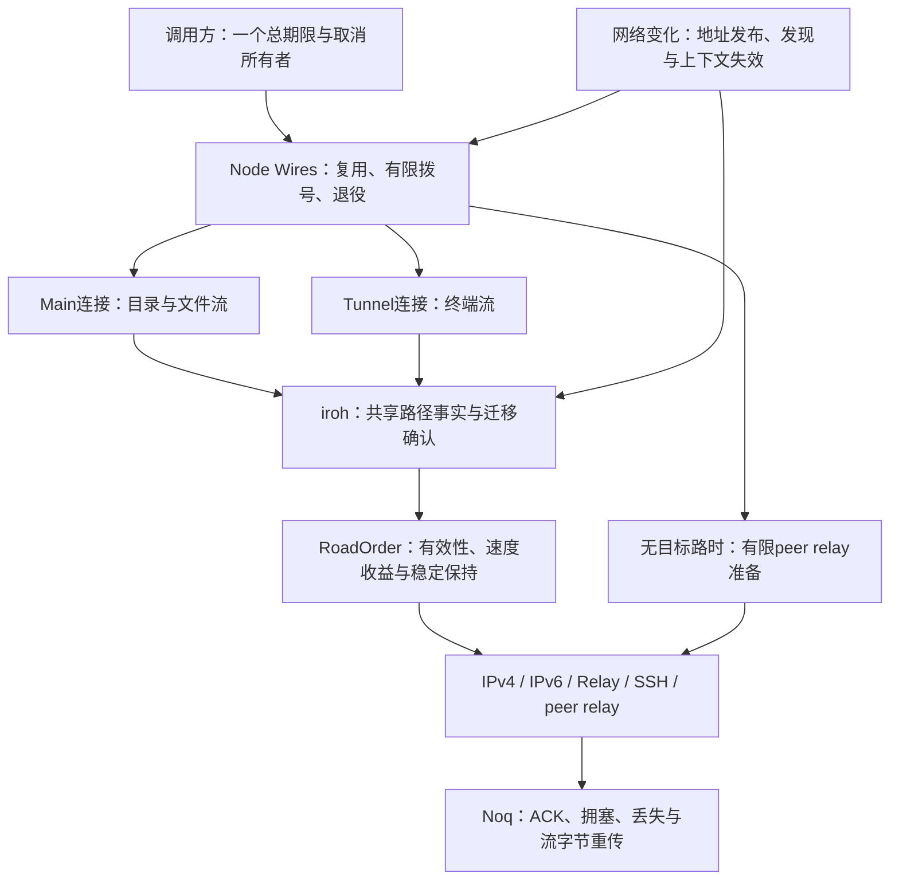

# 网络设计与职责边界

2026-11-13 更新，实施中的设计记录，完整最优设计尚未验收。下文带旧源码编号的段落记录设计演进；当前实现、通过范围与未完成项以 STATE 中准确源码证据为准。

## 当前收敛的结构与决策

候选 `integrate/net-product-v2 @ 3093f866` 使用 iroh1.4.1 / Noq1.4.0，runtime 与已测 R9081b94d 相同，尚未晋升到 canonical feat/net。版本升级不表示已经移除本地补丁。GUI 与 workflow 仍冻结在公开 main c3b098bd，本轮没有界面、安装或发布动作。

Main/Tunnel 的分离本来就存在，不是本轮新增隔离方案；同一 peer 的质量共享也不意味着每条连接都有同一组已开放路径。目录与文件在 Main 内的排队、实际已发送字节以及外层承载仍需分别测量。

| 问题 | 当前决定及依据 | 仍未据此证明的事情 |
| --- | --- | --- |
| 唯一存活邻居被旧失败冷却挡住 | 有限 Ask/Forced、无目标路且首腿真实开放时，复用原3秒hop预算作为实际再试最小间隔；准备、等待与业务仍共用原调用期限。背景比较与死首腿保留退避。R物理3/3恢复及Linux/Mac相同92项通过 | 全部NET16、多middle移动、全网恢复成本 |
| NAT映射变了但共享tuple过时 | 保留iroh patch38。当前R/M固定6块，R强属性3/3、删补丁0/3且215次cached/actual mismatch；数据交付成功不能替代真实新tuple被选中的合同 | 所有IPv6隐私地址/前缀、双端与middle同时移动 |
| 拥塞控制是否全局换CUBIC | 不换。当前Noq固定矩阵里2%丢包CUBIC/BBR吞吐中位0.326/10.067Mbit/s，0%的小burst尾延迟也非CUBIC全面占优 | BBR已最优，或Noq模型已解释真实Node的2秒超时 |
| 是否扩大连接副本的补探测 | W消融在普通Release仍有原2秒超时和秒级终端排队，拒绝作为修复 | 开更多副本能解决混合负载 |
| 是否禁用Relay以减少卡顿 | 不新增产品禁用开关。空only_mine清单会按已有设计恢复内置Relay；旧隔离实验前置无效。当前只在私有实验里保持相同有效配置、改变真实Relay的可用性 | 发布了候选就存在活的多路径copy，或生产关闭中继值得采用 |

当前BBR测量包含现有Noq本地补丁，不能叫作“未修改的上游BBR”。选择最新稳定版本、保留哪项补丁、最终选哪条路分别需要证据。待完成的关键决策仍是：真实负载下的质量与稳定性、同连接调度和进一步隔离的收益、1/3/5设备开销、移动恢复与手机能耗，以及逐项custom退出。

## 体验目标和决策顺序

先遵守用户配置与设备信任边界，再排除不可用路径，最后比较实际测量。路径类型用于说明承载方式，不具有性能优先权。

同一对端的直连、中继、SSH 承载和设备转发使用端到端测量。未知带宽不参与吞吐比较，过时或缺少样本不表示更快。当前首版的可用输入是 RTT 与不应答状态；抖动、样本可信度和工作负载指标仍需 N0/N1 后续补齐，不能将首版 RTT 排序称为整个计划的最优设计。

## 谁决定什么

| 层 | 状态所有者 | 决定 | 不应替它决定的事情 |
| --- | --- | --- | --- |
| 包与路径恢复 | noq/QUIC 的连接与路径 | ACK、损失检测、重传、拥塞与流控 | 不决定用户请求能否重放 |
| 路径事实 | iroh RemoteStateActor / Measured | 各连接对同一网络路径的观测、应答与样本新鲜性 | 不把连接协议名当作路径性能 |
| 路径策略 | khor RoadOrder | 根据有效观测提出当前路径与备用 | 不直接重拨应用请求或放宽准入 |
| 迁移确认 | iroh Moving | 为候选取得新鲜证据、确认或放弃迁移 | 不无条件放行“升级到直连” |
| 连接生命周期 | Node Wires | 对端/协议连接复用、互斥拨号、退役、后台退避 | 不把远端计算慢当作路径失效 |
| 请求生命周期 | 调用方与 exchange | 总期限、取消、读写重试语义 | 不在每层重新给予完整等待预算 |
| 中继登记/寻址 | endpoint 与网络报告 | 可达入口、地址发布/发现、家中继 | 单端探测不足以替代完整设备间路径测量 |
| 应用体验 | 终端/文件/会话调用方 | 首份内容与交互/批量的优先级 | 不自行建立第二套连接健康判断 |

## N1 首版选择流程

1. 每个 bind 注册 RoadOrder，一次性客户端和常驻节点遵守相同产品规则。自定义承载是否注册单独决定。
2. 读候选的有效 RTT 和不应答状态；已不应答的候选不参加正常排序。
3. 当前路径短暂停顿、停顿时间仍短于最快备用的 RTT 时，暂时保留，避免一次小卡顿变成更长的绕路。该规则对全部承载一致。
4. 没有有效当前路径时选择测量最快的候选；当前路径仍有效时要求候选超过收益门槛。
5. 首版收益门槛为 `max(5ms, 当前RTT/4)`；上次切换后一分钟内绝对底线为10ms，相对门槛仍为四分之一。相对门槛不再在高 RTT 路径上翻倍，避免刚选中慢路后长时间拒绝有意义的改善。
6. 对开放路径的每次迁移调用 Moving 确认。有限时间内为候选取得新样本，显著更快的候选可以快速通过；无新鲜证据时确认有上限与冷却，故障迁移走专门的 leave 规则。

5ms/10ms/25% 是首版待实验验证参数；ACCEPTANCE 固定的是用户可见行为。参数只有在新旧同条件对照支持时才调整。单元测试覆盖类别互换和近期切换的改善/噪声；netlab 负责实际连接、确认和调度行为。

## 尚需收敛的设计点

### 测量与备用发现（N1/N2）

新候选把传输恢复的平滑RTT与选路质量分开：noq保留原RTT/拥塞数学，另外公开最后ACK样本和递增样本计数；相同RTT数值也能证明新观测。Measured只在新ACK且采样包时间有效时记录观测，年龄来自ACK处理时刻，反复读取不刷新；保留最近2秒、最多8个观测的中位数作为选路质量，避免旧慢路平均值长期压住恢复。正常迁移需至少两个独立观测tick，故障离开仍只需一个新应答；确认预算/冷却保持。旧点过期时同步重算窗口中位数，窗口清空则保留最后已知质量用于探索；过期不增加ACK/新鲜确认记录。正常迁移与快速改善都要求候选包在决定开始后发出；快分支取得原两个独立新观测便可提前迁移，等待期间同时复测当前路，当前路RTT超过既有确认预算时仍不等待其应答。黑洞leave仍用独立快速通道，原收益/确认上限/冷却不变。

原机制在选中继后仍至少保留一条IP路径；多个IP候选可能只剩一条，因此关闭候选的重新发现仍需验证。新候选利用既有250ms观测tick，STREAM流量活跃时，每对端最多5秒一次、轮流探测已开放的非选中网络路径，跨连接去重；PING/ACK不续活跃窗口，闲置不新增timer，仍沿15秒备用保活。所有承载的选中路径均监测质量退化。p7七相位×三轮最新21项全绿，交互2.26–3.10秒/闲置2.51–18.41秒；这是过期修复后、快速确认修正前的准确源码证据，后者相位与CPU长稳仍在验证，实际探测成本未齐。

还需验证：长期闲置副本、卡顿积压样本、不同ALPN取样率、网络变化失效、样本年龄/置信可诊断，以及有限备用的重新发现。p7旧版两种负载均45秒不回Direct，是本候选的产品红证据；目标保持交互10秒、闲置20秒。

转发发现与清理使用同一改善函数 `improves`；已选Direct或Relay均按测量比较，不能仅因Direct身份移除更快hop。清理与保留的门槛与RoadOrder一致，避免两层互相撤销。

输入一致性补充：iroh通过现有PathState缓存发布选择器代表副本的质量、观测时刻与窗口样本量；`Path::measurement()`读取不探测，缓存更新不触发paths_stream。质量与年龄取同一副本，未观测ACK明确None。khor PathFact保留传输平滑RTT，并增加精确Duration质量/年龄与样本量；清理使用此质量，缺少质量时沿用选择器的传输估计回退。保留亚毫秒精度，测得0.x毫秒与未测得的0区分。两个旧平均值反转结论回归已红→绿，有66单元与431Noq/22iroh对应源证据。221b98fc另外在已有path事件附此缓存诊断，不改变展示句。Entry的u128内部tag兼容已真实取红并修正，42524575725正式持久化回读通过；事件字段是回调时的缓存快照，不冒充选择器内部决定时刻。转发与最终源实测仍需验证。

故障后的在飞数据是传输层职责：路径历史RTT不会因黑洞而变大，不能仅因两条路“同速”就把流字节继续留在已不应答的Backup。noq PathStats提供与iroh相同的PTO/等待/近期收包判据；迁移状态改变时，noq对不应答或明显慢的Backup重排可重传帧。健康同速保持原行为，应用请求不重新执行；原MTU排除、丢包拥塞计量与QUIC去重保留。先前确定性红→433Noq/22iroh绿及若干实际p3三轮绿均保留，但最新42527295249出现1.3秒/15.3秒，不能视为恢复已完成。新回归42529470019为434pass/1fail，确认只在状态改变时检查会漏掉稍后才不应答的Backup。当前候选在该Backup已有LossDetection/PTO事件置位，下一次poll_transmit再用同一判据重排，不增加独立timer或每次发送的扫描；健康同速及未满300ms停顿仍不重排。实际恢复、转发、稳定性另需准确新源证据，不把单元bug认作实际15秒全部定因。

样本时刻补充：Noq暴露采样包发送与ACK处理时刻，不改变原RTT计算；Reading窗口计龄以ACK处理时刻为准，只有新ACK计数和有效时间才入观测，初始估计只用于探索。确认要求采样包在确认起点后发出，排除积压旧包；静默恢复要求包在最后静默判定后发出。三个回归已确定性红，修复含额外静默覆盖后434Noq/26iroh全绿。ACK处理时间不是内核收包时间，真实恢复和CPU影响还需新源长回归；p7相位覆盖先冻结后实施，10/20秒门不变。

Watch探测与探索补充：近期窗口可能只有单次慢ACK，不能在开始探测的同一刻就按它触发打洞。
519ad4aa让普通慢质量持续原2秒窗口，并有两个采样包在本次确认后发出才允许打洞；恢复取消确认，
不重置原探测/打洞节流，不新增timer或普通闲置探测。已有STREAM样本也可提供证据。
真实无应答满原1秒独立通道、RTT超过整个2秒窗时的立即探索保留，不为极慢路径等额外往返；
探索不会直接强制移路。42531529275单次150ms先红，42532303734为435/33绿；实际p5/p1s及恢复仍在验证。

N1可用性补充（候选）：首次决定后新往返证明路重新可达，不应先要求quality更快或某种承载类型；
重复故障在原REHOLD窗内仍需SILENT_HOLD，质量是否值得迁移交给RoadOrder/Moving。
42539860644已436Noq绿/iroh33pass1fail；新候选不改变不应答门、确认/收益或copy-waking，实际防抖/恢复待复验。

### 建连与请求期限（N2）

连接准备与业务执行分开。先建立可用承载，随后仍由RoadOrder比较实际端到端表现；直连、公共Relay和peer relay不因类型获得性能优先权。总期限为调用方期限与当前hop准备预算的较早者，准备失败不能在下一层重新领取完整预算；业务写入不会因增加候选而重新执行。

当前恢复状态沿用已有所有者：

| 事实/资源 | 所有者与寿命 | 更新及失效规则 |
| --- | --- | --- |
| 本机网络上下文 | Wires拥有强token，操作/缓存只持弱token | 换网/恢复事件更新；旧操作不能在新网络写回失败或发布成功 |
| 路由观察顺序 | 读取roster/roadbook前捕获单调序号 | 在同一MISSED锁内拒绝晚登记的旧快照；成功也保留最新观察 |
| peer relay失败 | 原MISSED表中每middle的count/at | 只有实际尝试过的middle退避；未试第三个仍可进入下一轮，不新增另一张失败表 |
| 候选事实 | 规范化设备ID、实际可达、首腿连接身份/实际IP或Relay地址、弱连接handle | 成本、排序、重复读取不刷新；同网络同活wire才延续该middle失败，新实际wire/地址不继承旧拒绝 |
| 在飞完成 | 只持弱candidate token | 新上下文和成功替换token，旧拒绝/旧快照/旧成功不能改变更新的结果 |
| 发起端提交 | 原network-generation → MISSED → Links锁，均为同步短操作 | 当前network/candidate、原期限与现有承载策略核对通过才挂载；实际接受后才清失败并替换token，不新增提交表 |
| 本地carrier发布 | 原PendingHop与handoff watcher，attachment serial | 放弃者撤回自身offer；实际消费者可接管所有权；旧watcher不能关闭后继attachment |
| 目标端carrier提交 | 单个入站流的准备future，完整首帧后原Links表 | OK只表示准备，不先替换现有peer；只有赢家发送的完整承载帧才提交，输家取消不影响活路 |

7d源已在Mac/Turing准确同源全部12组/hop76通过，含未试第三middle、挂起第一middle、目标端迟到准入覆盖活TLS/echo的旧红→绿。当前legacy兼容路径按剩余候选分配同一总期限，准备超时取消该请求流，不把outer连接判死。

c2b候选在此之上增加最多两个借用父操作的prepared future，并行准备且仅取一名赢家，剩余future在carrier发布前释放。`hop_staged`是设备表的自报hint；它可能在降级后残留，所以不作为并发提交的授权。真正的`hop-ready`与`hop-ready-in`必须分别由中间节点和目标解析并给出正向准入。旧节点对这些带空格且不是TCP地址的词不会误授legacy通路。若准备不能完成，仍在原期限内走有界legacy；目前预留剩余预算一半供该回退，是待完整高RTT/成本对照确认的候选安排，不能当最终参数。

目标端在原线上帧格式内等待一份完整u16长度承载帧，最多65537字节；然后把前缀原样送入现有transport，内层仍是端到端加密。未提交的准入有有限等待，不增加常驻map、独立后台timer或第二套健康判断。提交前复核现有hop、成员、SSH和双端竞争门。初始化协议与承载字节不写日志；诊断只保留计数、时间与所有权事实。

c2b的三个新增实际TLS/echo合同在Mac/Turing同源全部12组通过（总hop79），覆盖首个prepared status挂起、两个Ready只有一次数据提交/输家STOP_SENDING，以及过期hint被真实拒绝后legacy救通；完整物理两腿竞争尚未接受。

0d1c对目标和middle的有效拨号hint按现有dial_addr（含nearby）解析后排序去重，IPv4/IPv6实际hint变化使对应旧失败失效，顺序/重复/无效项不取消冷却。四个独立真实endpoint身份/地址族probe加carried TLS/echo合同在旧源失败，同合同候选双OS全部12组/hop87通过；这不是完整物理第二腿或同connection移动验收。

迟到成功的原逻辑在976d4源实测hop88通过/1失败：新消费者已成功并释放后，旧Ask在原3秒期限内收到OK仍重新挂载。453399→格式67929候选将网络代次、候选所有者、原期限与现有SSH/双端竞争策略的核对和挂载放入上述同步提交边界。Links的条件挂载在同一注册表锁内检查当前carrier并插入；拒绝时保留现有serial、实际I/O及last_carrier，不写成功journal、不清当前失败。锁内无await/文档I/O；Wires其他generation方法不在持锁时回调MISSED，Links回调不再进入其自身表，无逆序获取路径。67929同源候选已在Mac/Turing全部12组通过（hop89、net68+1ignored）；旧原逻辑的迟到成功红项到同合同候选绿已成立，不能外推为完整物理或手机接受。目标端首帧后的策略检查仍有独立边界，完整并发/撤销与物理验收继续跟踪。

仍需完成：同一connection上的真实IPv4/IPv6迁移、有效hint变化后的完整物理第二腿、LOST本机身份/上下文、取消后迟到成功的完整组合、多节点同时恢复、公平与探测成本。准备/receiver等待预算必须继续测高RTT与调度停顿，不能把3秒或预算分割直接当作最优设计。对实际partial/uncommitted帧、旧版本混合和完整双腿还需接受。保留原读写重试/0-RTT安全边界；非幂等操作结果未知时不得自动重放。

### 首次握手与共享选路边界（N2/N4，候选待验）

四真实resident实测揭示，准备成功不等于连接已能使用carrier：N约300ms正向准入，原握手却没有发出承载首帧，目录1.5秒合同三轮失败。iroh在握手完成后才把连接注册给路径管理；另一条仍活的Relay连接可决定endpoint-id初始报文去向。只给已注册连接offer_addrs不能保证尚未完成的握手改用新承载，清空全局选择也不适用于仍有其他活连接的情况。

新候选只约束一次连接的首个Custom transport，地址须显式给出，TLS仍认证目标EndpointId。共享地址提示、其他连接和认证后的质量选择继续由原所有者管理；不通过全局清缓存逼所有连接换路。普通拨号在准备就绪时取消并join一个原Relay future才复用其名额，最多两个活动拨号，保留原Direct竞争。早发路径保留原0-RTT读取机会，旁路的普通握手不发early业务；原路先完成仍沿原响应，替代先完成则取消旧早发任务并走既有正常读取门。替代最多一次、失败不领第二份预算或再试一个carrier；写操作和rides_early集合不扩大。

这增加了必要场景下的有限握手工作，不能声称流量或能耗不变。真实活IP连接旁的新Custom Path0/TLS/echo、错误身份拒绝、原IP连接存续和API输入门必须先通过，再核冻结四peer首内容、连续性、取消/旧完成及N3成本。准确候选及结果见STATE；这是待验设计，不是N2/N4完成结论。

### 已安装carrier的初始路竞争（候选）

已有carrier也需要一次独立初始目的地机会；把它仅塞入generic地址集合，仍会被同peer另一个活连接的共享selected route遮住。普通拨号沿原两个槽保留generic路，将第二个重复identity-only拨号替换为显式Custom普通握手；early保留原0RTT读取竞争一个普通Custom握手，不向替代路径发送early业务。原generic路的失败若尚有Custom在途，不提前决定，认证resting仍终止；两者都失败沿原失败结果/期限退出。original future与其early answer owner输掉时取消，不能增加第三次carrier尝试或扩大写重放。

这会让已有carrier在快Direct场景也可能开始额外握手，必须在N3测CPU/字节/手机开销，两个slot不等于原成本不变。真实旧573在活IP控制和fastDirect负控通过时，两普通/early完整业务都无响应；候选尚待同源合同与物理接受。

### 混合负载（N3）

先测应用队列、服务器并发席位、流调度、发送缓冲和承载外层流各占多少延迟，再选择优先级或隔离。优先级不能撤回已在飞行的批量字节，因此需要同时验证排队/在途量与背压。

候选包括同连接的流优先级和有限批量、必要时的独立连接。比较交互 p95/p99、批量完成时间、整体开销；选择能兼顾公平推进的方案。个人设备网拓扑不因假想规模问题先行替换。

### 中继与发现（N4）

用户允许的中继集合是硬约束。家中继选择解决登记与可达入口，实际设备间路径选择解决端到端体验，这两个问题不能混为一个延迟排名。

先用双端不对称可达性、单家故障和地址失效场景验证当前机制，再决定第二登记点/双家及新增节点。新增中继数量不是验收指标；可替代路径是否真的被找到和使用才是。

## 验证与交付

- 短回归必须证明旧策略红、候选绿，并保留原恢复/安全边界。
- 防抖、旧样本、路径恢复和转发需要动态场景；初始路径比较不足以证明这些要求。
- 可重复的 Linux 实验和 Mac 原生/实际手机证据分别记录，禁止互相替代。
- 所有结论绑定 source tree、控制 driver commit、执行器条件和完整失败记录。

当前实现已覆盖N1测量/确认与多项N2恢复/所有权合同，并保留真实红项及其版本。N0最终体验证据、N1长尾与单向stall、完整N2移动/竞争成本、N3共存、N4物理两腿/地址族与N5审计和真机均未完成；准确状态见STATE。

### 比较工作随事实失效（2026-11-11候选，待物理对照）

19cceb将比较工作记录放进原MISSED的每个middle，以实际网络、候选和首腿事实定义寿命。相同事实保留30秒的比较间隔；新增实际middle、真实首腿替换或网络上下文变化可以及时比较。未试的候选不继承已经尝试的其他middle的时间，前台恢复继续受原失败退避与总期限约束，不因改善比较的周期而额外等候。

同锁claim拒绝旧weak epoch和已到期调用方；成功保留工作记录，只退役旧完成事件。不存在新的全局表、后台timer或独立observer。移除进程全局LAST_COMPARE使不同目标/Node不再共享一次比较时间；但原全局门与每middle门的总工作上限不同，个人网1/3/5设备成本与quiet稳定性必须实测，不能从保留“30秒”推断总开销不变。当前Mac仅首轮失败待核是否格式；Turing准确c2b修改前原矩阵仍在跑，首轮f4i28.2秒、次轮17.8秒说明长尾尚在。没有新候选物理收益结论。

## 前台Relay静默恢复候选（2026-11-14，尚未接受）

RELAY-DEMAND记录准确I2/R普通Release在原几何中3/3真实前台红：每场10次2秒超时，约20.04秒首有效目录内容。空闲30秒恢复合同不代最佳体验。隔离候选81ae5c98保留原测试与期限。

请求层只在有活请求、开始后尚未收到对端任何QUIC datagram、选中的路径为Relay且达到max(250ms,3×当前路RTT)时，提示现有Relay健康检查；最多一次成功入队，队列满时只在同一个请求剩余beat内再试。收到任意datagram就不启动这一早期提示，并不声称它是当前请求的ACK；请求后半程的静默仍由既有wire看守和transport负责。当前仅resident endpoint入口，没有验证one-shot全路径。

Endpoint通过现有有界socket actor队列转交。实际TCP的ActiveRelayActor拥有一个未完成health ping：并发提示加入当前检查，只有匹配pong清除，原timeout/reconnect仍归iroh；周期ping不能覆盖该检查的deadline。新TCP重新开始该状态。没有新后台周期timer、没有全endpoint rebind，也不因业务处理慢直接retire QUIC或重放应用写入。

V1以500ms节流合并被静态审查否决：上游PingTracker每次new_ping覆盖deadline，可能被并发提示反复推迟；保留其原生compile但未运行/晋升。V2新增原生deadline与pong合同，还须原3场、慢健康Relay/长Accepted、取消/资源与实际后台成本回归。健康探测RTT抖动、发送队列已堵时的normal inbox可达性、收到旧datagram、持久TTY/其他协议及反复故障仍属未验范围。此窄修复不能关闭完整N2/N3/N4或手机现场。

候选的resident exchange入口也供后台同步使用，没有按UI前后台标记过滤。没有活请求时不会由本改动新增检查，但后台同步本身仍是实际请求，不能据此宣称闲置流量或能耗不变；需真实1/3/5设备与手机记录。
